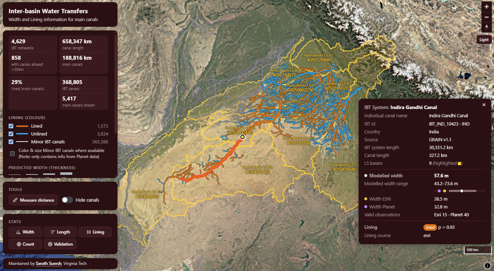

# Inter-basin Water Transfers: Canal Width and Lining Viewer

**[Open the viewer →](https://sureshsarath.github.io/IBT_Visualizer/)**

An interactive map of the world's **inter-basin water transfer (IBT) canals**: canals that move water from one river basin into another. For the major canals it shows how wide each canal is and whether it is lined (concrete or similar) or unlined (earthen), estimated from satellite imagery.

## What you can do

- **Explore canals worldwide.** Main canals are coloured by lining (orange = lined, blue = unlined) and drawn thicker the wider they are. Smaller (minor) IBT canals are shown as thin lines.
- **Click any canal** to see its IBT system, country, length, modelled width with an uncertainty range, the separate image-based width estimates, its lining class, and the HydroBASINS (level 5) basins its system connects.
- **Focus on one system.** Clicking a canal highlights its whole connected IBT system and the basins it links.
- **Browse statistics.** Charts for widths, lengths, lining and IBT counts by country, plus a training and validation summary. Click a bar or dot to jump to it on the map.
- **Measure distances, switch basemaps** (Google Satellite, Esri World Imagery, Light), and use a light or dark theme.

## At a glance

| | |
|---|---|
| IBT networks | 4,629 in 69 countries |
| IBT canals | 368,805 (658,000+ km) |
| Main canals with width and lining | 5,417 (≈189,000 km) |
| Ground-truth canals used for validation | 729 hand-measured widths in 53 countries |

## Data sources

- **Canal network:** IBT canals derived from GRAIN canals, plus additional United States canals from the USGS [3D Hydrography Program (3DHP)](https://www.usgs.gov/3d-hydrography-program).
- **Basins:** [HydroBASINS](https://www.hydrosheds.org/products/hydrobasins) level 5 (WWF / HydroSHEDS).
- **Imagery used for the estimates:** Esri World Imagery and PlanetScope (Planet Labs, provided through the NASA Commercial SmallSat Data Acquisition program).
- **Country outlines:** [Natural Earth](https://www.naturalearthdata.com/).
- **Map rendering:** [MapLibre GL JS](https://maplibre.org/) and [PMTiles](https://protomaps.com/docs/pmtiles).

## Notes

- Widths and lining are **model estimates**, not survey measurements. Each canal's popup shows the uncertainty range and the sources used.
- Lining for minor canals comes from a single imagery source and is marked **provisional**.
- This is a research product and is still being developed; numbers may change between versions.

## Citation

A paper describing the dataset is in preparation. Until then, please cite this viewer as:

> Suresh, S. (2026). *Inter-basin Water Transfers: Canal Width and Lining Viewer.* Virginia Tech. https://sureshsarath.github.io/IBT_Visualizer/

## Contact

Maintained by [Sarath Suresh](https://sureshsarath.github.io/), Virginia Tech.

## License and use

© 2026 Sarath Suresh. All rights reserved. The viewer and the data shown in it are provided for viewing and non-commercial research use only. Please do not redistribute or scrape the underlying data files without permission. Third-party data remain subject to their providers' terms.
